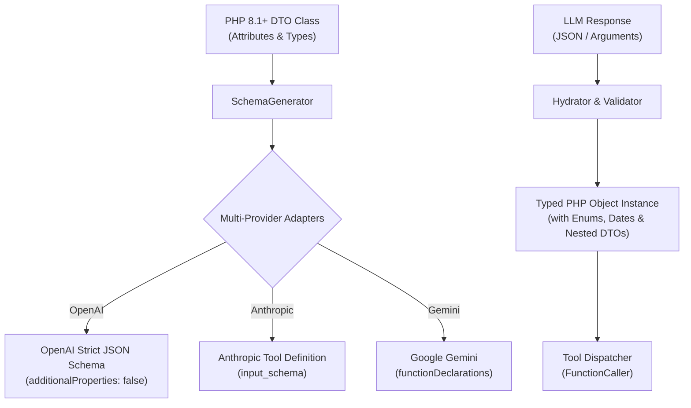

# AI-Function-Caller-PHP

[](https://php.net)
[](LICENSE)
[](#)
[](tests/)

**AI-Function-Caller-PHP** is a zero-dependency, type-safe PHP 8.1+ library that translates standard PHP classes and Data Transfer Objects (DTOs) into strict JSON Schema for **OpenAI**, **Anthropic Claude**, and **Google Gemini** — and automatically parses, validates, and hydrates LLM responses back into strongly-typed PHP objects.

In the TypeScript ecosystem, libraries like Zod and Braintrust made structured outputs enjoyable. In PHP, developers often struggle with writing bulky JSON schemas by hand, maintaining duplicated schemas, and dealing with loosely-typed `json_decode()` arrays.

**AI-Function-Caller-PHP** solves this completely.

---

## 🚀 Key Features

- **Native PHP 8 Attributes**: Annotate your DTOs and tool methods using `#[Field]`, `#[Description]`, `#[Items]`, `#[Min]`, `#[Max]`, `#[Pattern]`, `#[Enum]`, and `#[Tool]`.
- **Tri-Provider Parity**:
  - **OpenAI**: Strict Structured Outputs (`json_schema` with `strict: true` and `additionalProperties: false`) & Tool/Function Calling.
  - **Anthropic Claude**: Full `input_schema` and `tool_result` formatting for Claude 3.5 Sonnet / Opus.
  - **Google Gemini**: OpenAPI 3.0 `functionDeclarations` and `functionResponse` mapping.
- **Automatic Hydration & Validation**:
  - Recursive instantiation of nested DTOs.
  - Native PHP 8.1 Backed Enums (`BackedEnum::from()`) and pure enums.
  - ISO 8601 date parsing (`DateTimeImmutable` / `DateTime`).
  - Typed array collections via `#[Items(OrderItem::class)]`.
  - Boundary constraint validation with exact JSON-path errors (`customer.email`, `items[0].quantity`).
- **Zero External Dependencies**: Lightweight and fast; includes a standalone PSR-4 autoloader.
- **Built-in CLI Tool (`bin/ai-caller`)**: Inspect schemas, test tool dispatches, and validate payloads from your terminal.

---

## 🏗️ Architecture



---

## 📦 Installation

Install via Composer:

```bash
composer require anton-barinov/ai-function-caller-php
```

Or clone directly (zero dependencies needed):

```bash
git clone https://github.com/Anton-Barinov/AI-Function-Caller-PHP.git
```

And require the built-in autoloader:

```php
require_once __DIR__ . '/path/to/AI-Function-Caller-PHP/src/autoload.php';
```

---

## ⚡ Quickstart: Structured Outputs

Define your DTO using native PHP 8 types and attributes:

```php
<?php

use AiFunctionCaller\Attributes\Description;
use AiFunctionCaller\Attributes\Field;
use AiFunctionCaller\Attributes\Items;
use AiFunctionCaller\Attributes\Min;
use AiFunctionCaller\Attributes\Pattern;
use AiFunctionCaller\FunctionCaller;

enum Priority: string
{
    case LOW = 'low';
    case MEDIUM = 'medium';
    case HIGH = 'high';
}

#[Description('An action item extracted from meeting notes')]
class ActionItem
{
    public function __construct(
        #[Field('Short title of the task')]
        public readonly string $task,

        #[Field('Assigned person full name')]
        public readonly string $assignee,

        #[Field('Urgency level')]
        public readonly Priority $priority,

        #[Field('Due date in ISO 8601')]
        public readonly DateTimeImmutable $dueDate,

        #[Field('Estimated hours to complete')]
        #[Min(0.5)]
        public readonly float $estimatedHours
    ) {
    }
}

#[Description('Extracted meeting summary with action items')]
class MeetingSummary
{
    /**
     * @param list<ActionItem> $actions
     */
    public function __construct(
        #[Field('Meeting title or subject')]
        public readonly string $title,

        #[Field('Key takeaways')]
        #[Items('string')]
        public readonly array $keyTakeaways,

        #[Field('List of assigned action items')]
        #[Items(ActionItem::class)]
        public readonly array $actions
    ) {
    }
}
```

### 1. Send Schema to OpenAI

```php
$caller = FunctionCaller::create();

// Generate OpenAI Structured Outputs response_format:
$format = $caller->getOpenAiStructuredOutput(MeetingSummary::class);

/*
Pass $format directly into OpenAI Chat Completions payload:
[
    'model' => 'gpt-4o',
    'messages' => [...],
    'response_format' => $format
]
*/
```

### 2. Parse & Hydrate LLM Response

When the LLM finishes generation, parse the string back into your PHP object:

```php
$llmRawJson = $response['choices'][0]['message']['content'];

/** @var MeetingSummary $summary */
$summary = $caller->parse(MeetingSummary::class, $llmRawJson);

// Fully typed object access!
echo $summary->title; 
echo $summary->actions[0]->assignee;
echo $summary->actions[0]->priority->value; // Enum instance
echo $summary->actions[0]->dueDate->format('Y-m-d'); // DateTimeImmutable
```

If the LLM output violates constraints, `ValidationException` is thrown with descriptive path errors:
```php
try {
    $caller->parse(MeetingSummary::class, $badJson);
} catch (\AiFunctionCaller\Exceptions\ValidationException $e) {
    // e.g. "actions[0].estimatedHours: Value 0.1 is less than minimum 0.5"
    print_r($e->getErrors());
}
```

---

## 🛠️ Quickstart: Function Calling / Tools

Register service classes or closures as tools and let **AI-Function-Caller-PHP** manage schema export and execution.

```php
<?php

use AiFunctionCaller\Attributes\Field;
use AiFunctionCaller\Attributes\Min;
use AiFunctionCaller\Attributes\Tool;
use AiFunctionCaller\FunctionCaller;

class ECommerceTools
{
    #[Tool('check_inventory', 'Check current stock level for an item')]
    public function checkInventory(
        #[Field('Product SKU')]
        string $sku
    ): array {
        return ['sku' => $sku, 'in_stock' => true, 'quantity' => 45];
    }

    #[Tool('calculate_shipping', 'Calculate shipping rate based on weight and country')]
    public function calculateShipping(
        #[Field('Destination 2-letter ISO country code')]
        string $country,

        #[Field('Total package weight in kg')]
        #[Min(0.1)]
        float $weightKg
    ): array {
        $cost = $country === 'US' ? $weightKg * 5.0 : $weightKg * 12.0;
        return ['country' => $country, 'shipping_usd' => $cost];
    }
}

$caller = FunctionCaller::create();
$caller->registerClass(new ECommerceTools());

// 1. Get tool definitions for your model:
$openAiTools = $caller->getOpenAiTools();
$anthropicTools = $caller->getAnthropicTools();
$geminiTools = $caller->getGeminiTools();

// 2. Dispatch incoming tool calls automatically:
// OpenAI:
$toolMessage = $caller->handleOpenAiToolCall($openAiToolCall);

// Anthropic:
$toolResultBlock = $caller->handleAnthropicToolCall($anthropicToolUse);

// Gemini:
$geminiResponse = $caller->handleGeminiToolCall($geminiFunctionCall);
```

---

## 💻 CLI Tool

The package includes a convenient CLI utility: `bin/ai-caller`:

```bash
# Display help and commands
bin/ai-caller help

# Generate OpenAI schema for a class
bin/ai-caller schema "App\DTO\CustomerOrder" --provider=openai

# Generate Anthropic Claude input_schema
bin/ai-caller schema "App\DTO\CustomerOrder" --provider=anthropic

# Generate Google Gemini function declaration
bin/ai-caller schema "App\DTO\CustomerOrder" --provider=gemini

# Validate and hydrate JSON into a DTO
bin/ai-caller validate "App\DTO\CustomerOrder" '{"orderId": 12, "total": 99.5}'

# Test-invoke a tool method directly
bin/ai-caller call "App\Services\TaxService" "calculate" '{"amount": 100}'
```

---

## 🧪 Testing

Run the included standalone test suite:

```bash
php tests/run_tests.php
```

Or run individual examples:

```bash
php examples/01_structured_output.php
php examples/02_function_calling_openai.php
php examples/03_multi_provider_parity.php
```

---

## 📄 License

This library is open-source software licensed under the [MIT License](LICENSE).  
Maintained by [Anton Barinov](https://github.com/Anton-Barinov).
